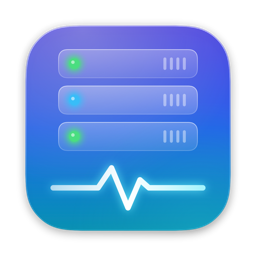
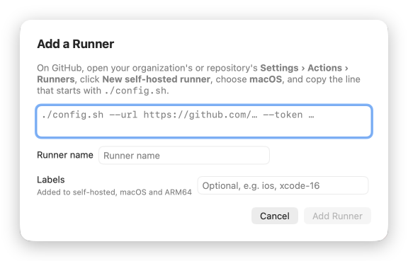
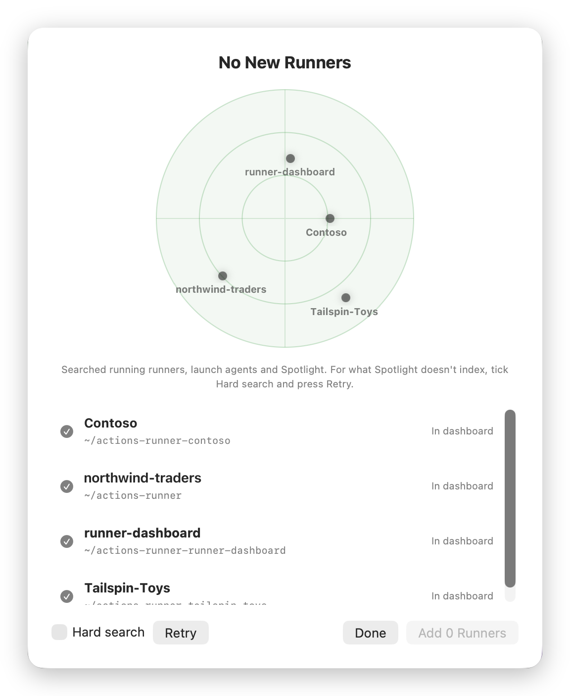

<p align="center">
  
</p>

<h1 align="center">Runner Dashboard</h1>

<p align="center">
  Watch and manage the self-hosted GitHub Actions runners on your Mac, right from the menu bar.
</p>

<p align="center">
  <a href="https://github.com/maheshBawa/runner-dashboard/releases/latest"></a>
  
  
  <a href="https://github.com/maheshBawa/runner-dashboard/actions/workflows/release.yml"></a>
</p>

<p align="center">
  
</p>

## Install

You need macOS 14 or later on Apple silicon. Run this in Terminal:

```sh
curl -fsSL https://raw.githubusercontent.com/maheshBawa/runner-dashboard/main/scripts/install.sh | bash
```

It installs the latest release into `~/Applications` and opens it in the menu bar. From then on, the app updates itself.

No GitHub login is needed. The app reads everything from the runners' own files and processes on your Mac.

## Features

### Everything at a glance


The **menu bar panel** lists every runner as idle, building or stopped, with the job it's running. It also shows CPU, memory, free disk space and network use. The menu bar icon animates while a job runs.

The **dashboard window** adds the network summary, the state of the Mac (CPU, memory, disk, power, thermal, Xcode DerivedData) and the most recent jobs across all runners, each linked to its run on GitHub.

Both show the app's version.

<br clear="right">

### A page for every runner

<p align="center">
  <br>
  <sub>Shown in dark mode: the app follows your Mac's appearance.</sub>
</p>

Each runner's page shows:
- **Resources:** live and 7-day CPU, memory and network use.
- **Storage:** what's taking up its disk space, with a one-click clean-up for old runner versions.
- **Health:** its service, listener and last activity.
- **Jobs:** build times over time, success rate, recent jobs and live logs.

### Add a runner in one paste



On GitHub, open your organization's or repository's **Settings › Actions › Runners › New self-hosted runner**, choose macOS, and copy the line that starts with `./config.sh`. Paste it into **Add Runner**, adjust the name and add labels if you like, and click **Add Runner**.

The app then:
1. downloads the latest runner
2. registers it with GitHub, using your shell's environment so jobs find Homebrew, Java and the Android SDK
3. starts it as a background service

<br clear="right">

### Find runners already on your Mac

<p align="center">
  
</p>

Runners in `~/actions-runner*` folders show up by themselves. For runners set up elsewhere, click **Find Runners**: a radar sweeps while it searches, and each runner pings onto it the moment it's found.

- **Normal search** runs right away. It checks running runners, installed runner services and Spotlight, for every user on the Mac.
- **Hard search** goes further: tick it and press **Retry** to also look through every folder on the disk, external drives included.

Tick the runners you want and click **Add**. Runners that belong to another user, or that were started by hand with `./run.sh`, are shown but can't be started or stopped from the app.

### Keep the Mac healthy

- **Controls:** start, stop and restart runners. Stop always asks first.
- **Disk space:** clean a runner's workspace, remove old runner versions or clear Xcode DerivedData. Optionally, idle runners clean up automatically when space runs low.
- **Network usage:** the data each runner uses and the data used on each Wi-Fi network, by hour, day or month. Set a monthly data cap to get alerts at 80% and 100%.
- **Notifications:** when a job fails or succeeds, when a runner goes offline on its own, or when free disk space runs low.
- **Power:** keep the Mac awake while a job runs, and pause idle runners on low battery.
- **Open at login.**

### Updates itself

The app checks for a new release every hour. When one is out, the menu bar panel shows **Update available**: click **Update now**, and the app downloads, installs and relaunches itself. To check right away, use Settings › **Check for Updates…**.

## Build from source

You need Xcode 16 or later.

```sh
git clone https://github.com/maheshBawa/runner-dashboard
cd runner-dashboard
scripts/build.sh
```

This builds the app, installs it into `~/Applications` and runs its self-check. [CLAUDE.md](CLAUDE.md) covers the code layout and the gotchas.

## Release

**[Release a new version →](https://github.com/maheshBawa/runner-dashboard/actions/workflows/release.yml)**

1. Open the link above and click **Run workflow**.
2. Choose `patch`, `minor` or `major`, then click **Run workflow** again.

CI then bumps the latest tag (v1.2.3 becomes v1.2.4, v1.3.0 or v2.0.0), tags `main`, builds and signs the app, and publishes the release. Installed copies offer the update within an hour.

The build runs on the repo's self-hosted runner, so that Mac must be awake with the runner online. Until then, the release waits in the queue.
