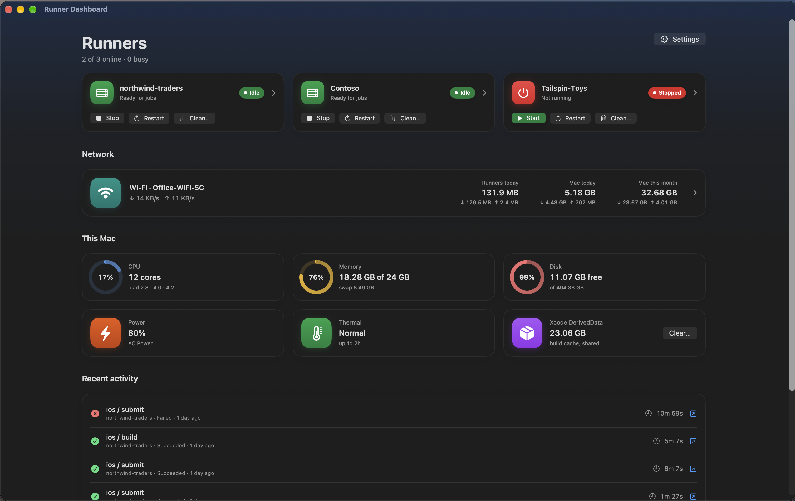
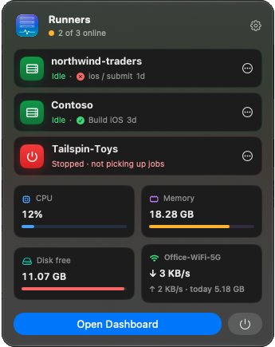
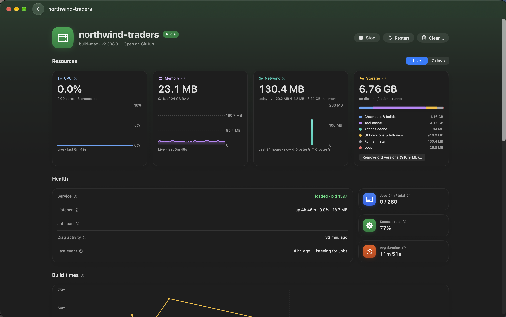

# Runner Dashboard

[](https://github.com/maheshBawa/runner-dashboard/actions/workflows/release.yml)

A macOS menu bar app for watching and managing the self-hosted GitHub Actions runners on your Mac.

It finds every runner in `~/actions-runner*` that runs as a launch agent. No GitHub token is needed: everything comes from the runners' own files and processes.



## Install

You need macOS 14 or later on Apple silicon. Run this in Terminal:

```sh
curl -fsSL https://raw.githubusercontent.com/maheshBawa/runner-dashboard/main/scripts/install.sh | bash
```

It installs the latest release into `~/Applications` and opens it in the menu bar.

## Features



- **Menu bar panel**: every runner at a glance (idle, running a job, or stopped), with CPU, memory and network use. The icon animates while a job runs.
- **Dashboard window**: a page for each runner with:
  - recent jobs, with links to their runs on GitHub
  - build times and success rate
  - live logs
  - CPU, memory, disk and health
- **Controls**:
  - Start, stop and restart runners. Stop always asks first.
  - Free disk space: clean a runner's workspace, remove old runner versions, or clear Xcode DerivedData.
- **Network usage**: the data each runner uses, and the data used on each Wi-Fi network, by hour, day or month. Set a monthly data cap to get alerts at 80% and 100%.
- **Notifications**: when a job fails or succeeds, when a runner goes offline on its own, or when free disk space runs low.
- **Automation**, each optional:
  - Keep the Mac awake while a job runs.
  - Clean idle runners' workspaces when disk space is low.
  - Pause runners on low battery.
- **Open at login**, and in-app updates.

<br clear="right">



## Updating

The app checks for a new release every hour. When one is out, the menu bar panel shows **Update available**: click **Update now**, and the app downloads, installs and relaunches itself. To check right away, use Settings › **Check for Updates…**.

## Build from source

You need Xcode 16 or later.

```sh
git clone https://github.com/maheshBawa/runner-dashboard
cd runner-dashboard
scripts/build.sh
```

This builds the app, installs it into `~/Applications` and runs its self-check. [CLAUDE.md](CLAUDE.md) covers the code layout and the gotchas.

## Release

**[Release a new version →](https://github.com/maheshBawa/runner-dashboard/actions/workflows/release.yml)**

1. Open the link above and click **Run workflow**.
2. Choose `patch`, `minor` or `major`, then click **Run workflow** again.

CI then bumps the latest tag (v1.2.3 becomes v1.2.4, v1.3.0 or v2.0.0), tags `main`, builds and signs the app, and publishes the release. Installed copies offer the update within an hour.
